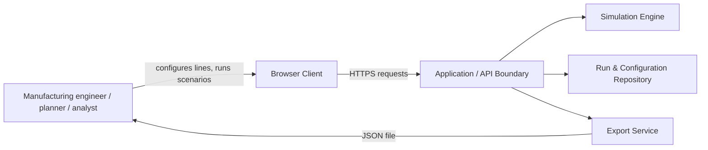
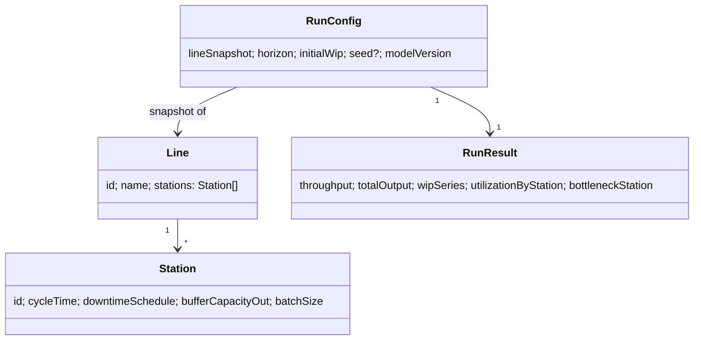

# Digital Twin Assembly-Line Simulation — High-Level Design

**Based on:** `digital-twin-assembly-line-requirements.md` (v0.2). Decisions referenced below (D-01..D-12) are defined in that document's Decision Log and are *Proposed* unless marked otherwise.

## 1. Purpose and Scope

This document describes the logical architecture of a web application that lets manufacturing engineers and analysts configure an assembly line, run baseline and scenario simulations, and review and export results. It is technology-neutral: it does not select a UI framework, programming language, database engine, or hosting platform. Those choices are implementation decisions for a later phase.

## 2. System Context

- **Browser client:** Presents line configuration forms, run controls, result dashboards, and scenario comparisons. Performs client-side input validation as a first line of defense; all validation is re-checked server-side (NFR-02).
- **Application/API boundary:** Stateless request handling; authenticates/authorizes requests (if multi-user), validates input, orchestrates simulation runs, and serves stored results. Treated as a logical boundary — it may be a single service or split further during implementation.
- **Simulation engine:** Pure, deterministic discrete-event simulation domain logic (Section 5). No direct UI or storage dependency, so it can be unit-tested in isolation (NFR-06).
- **Run & configuration repository:** Persists line configurations, run input snapshots, model version, seed, and computed results (NFR-01, FR-12). Storage technology is unspecified.
- **Export service:** Serializes a run's inputs, metadata, and results to JSON (D-09, FR-19).

The system has no live connection to production equipment, MES, ERP, or IoT sources (Section 3, out of scope).

## 3. Logical Components

| Component | Responsibility | Related requirements |
| --- | --- | --- |
| Line Configuration Editor (client) | Create/edit ordered station lists, buffer capacities, cycle times, downtime schedules, transfer batch sizes | FR-01..FR-04, FR-06..FR-08 |
| Validation Service | Reject invalid/inconsistent configurations with field-level messages, both client- and server-side | FR-04, NFR-02, AC-07 |
| Run Configuration Manager | Builds an immutable input snapshot for a run from a baseline + scenario overrides; never mutates the saved baseline | FR-10, FR-12 |
| Simulation Engine | Executes the deterministic discrete-event model over the configured horizon | FR-05, FR-09, FR-11, D-01..D-06 |
| Metrics Calculator | Computes throughput, output, utilization, WIP time series, bottleneck, from raw event trace | FR-13..FR-16, Section 7, D-07 |
| Run & Configuration Repository | Stores line configs, run snapshots, model version, seed, and results | FR-12, NFR-01 |
| Comparison Service | Diffs two runs' inputs and key metrics, flags mismatched horizon/units/initial conditions | FR-17, AC-08 |
| Export Service | Produces a JSON artifact with inputs, model version, seed, and results | FR-19, AC-09, D-09 |
| Result Dashboard (client) | Displays throughput, WIP over time, utilization, downtime impact, bottleneck, and comparisons | FR-13..FR-18, NFR-04 |

## 4. Domain Concepts

- **Line:** Ordered list of **Stations** connected by **Buffers** (finite capacity, including zero for direct transfer).
- **Station:** Identifier, fixed cycle time, optional scheduled downtime intervals, optional transfer batch size at its output.
- **Run:** An immutable snapshot of a line configuration plus horizon, initial WIP, and (if applicable) seed, associated with one set of computed results and a model version.
- **Scenario:** A run created from a baseline configuration with one or more overridden parameters; the baseline itself is never modified (FR-10).
- **Event trace:** The ordered sequence of simulation events (arrivals, processing completions, downtime start/end, transfers) produced by a run, from which metrics are derived.

## 5. Simulation Engine Responsibilities

- **Determinism:** Given identical `RunConfig` input (including seed, when applicable), the engine must produce byte-identical `RunResult` output (FR-11, NFR-01, AC-06).
- **Event ordering (D-06):** At equal timestamps, resolve in fixed order: downtime end → station completion/transfer → downtime start → new arrival. This ordering is a core invariant and must be covered by unit tests.
- **Horizon boundary (D-05):** Events scheduled exactly at the horizon end are not executed; a unit completing exactly then is not counted as output.
- **Initial WIP (D-03):** Units present at time zero are loaded into their configured station's in-process state and become part of WIP immediately; they count as completed output only if they finish before the horizon ends.
- **Batching (D-04):** Batch size governs transfer grouping at a station's output only. A station still processes one unit per cycle time; completed units accumulate until the batch size is reached, then transfer to the downstream buffer as one event. Partial batches at horizon end remain WIP, not output.
- **Downtime (D-02):** Only scheduled downtime (fixed offset/duration, one-/repeating) is modeled initially. The engine design should isolate downtime scheduling behind an interface so a future stochastic (MTBF/MTTR, seeded) model can be added without restructuring the event loop.
- **Blocking/starvation:** A station that completes a unit but has no downstream buffer capacity is blocked; a station with an empty upstream buffer and no unit to process is starved. Both states are tracked as time spent, separate from busy and scheduled-downtime time.

## 6. Validation

Server-side validation runs before any simulation starts (FR-04, NFR-02) and checks, at minimum:
- Station cycle time > 0.
- Buffer capacity ≥ 0 (integer).
- Downtime duration > 0 and scheduled within the horizon.
- Transfer batch size ≥ 1 (integer).
- Horizon > 0; initial WIP counts ≥ 0 and consistent with station existence.
- Units are the fixed set from D-08 (minutes, whole units); no conversion is attempted.

Validation failures return field-level messages (AC-07) and prevent a run from being created or recorded.

## 7. Reproducibility and Run Records

Each run persists (NFR-01, FR-12):
- The full input snapshot (line configuration, horizon, initial WIP, batch sizes, downtime schedule).
- Model version (identifying the simulation engine's semantics, tied to the Decision Log revision).
- Random seed, when a future stochastic feature is enabled; omitted/null for the deterministic initial-release model.
- Computed `RunResult` metrics and, if retained, the full event trace for diagnostics.

Scenario runs are always created by taking an immutable baseline snapshot and applying overrides; the baseline configuration record itself is never updated by a scenario run (FR-10).

## 8. Metrics and Comparison

Metrics Calculator implements the formulas in the requirements' Section 7 (throughput, total output, utilization, WIP, bottleneck), using the denominators and tie-break rules from D-07. The Comparison Service (FR-17, AC-08):
- Lists every differing input field between two runs.
- Reports the resulting difference in throughput, output, WIP, utilization, and bottleneck station.
- Flags (does not silently allow) comparisons where horizon, units, or initial WIP differ, since such comparisons can be misleading (Risks, Section 10).

## 9. Export

The Export Service serializes a single run to JSON containing: line configuration, horizon, initial WIP, model version, seed (if any), and summary results, sufficient to identify and, in principle, reproduce the run (AC-09, D-09). CSV export is explicitly deferred (D-09).

## 10. Non-Functional Considerations

- **Performance (NFR-03):** The simulation engine should process the provisional target of 20 stations and a 100,000-minute horizon within 5 seconds; the event-driven design (process only events, not fixed time steps) is chosen to meet this without committing to a specific runtime.
- **Security:** Treat all inputs as untrusted at the API boundary (OWASP input validation); do not expose internal file paths or stack traces in validation error messages; apply standard authentication/authorization if the system becomes multi-user or multi-tenant (not yet specified); avoid storing secrets in exported files.
- **Observability:** Each run record should be traceable by an identifier shown in the dashboard and export, to support later diagnosis of unexpected results.
- **Testability (NFR-06):** The simulation engine must be callable and testable without the API or client layers, enabling the deterministic unit tests implied by the Acceptance Criteria.

## 11. Verification and Model Validation

- Unit tests exercise the deterministic Acceptance Criteria (AC-01..AC-09) directly against the Simulation Engine and Metrics Calculator, independent of UI.
- Event-ordering (D-06) and horizon-boundary (D-05) rules get dedicated boundary tests, since they are easy to get subtly wrong.
- Before operational use, representative simulation results are compared against historical line data or an independently validated calculation, per the requirements' Section 11; this validation is a stakeholder activity, not a software test.

## 12. Open Items for Later Design Phases

- Concrete technology stack, authentication model, and deployment/hosting platform (NFR-07, D-12).
- Whether multiple users/lines require multi-tenancy or access control.
- Whether the event trace is persisted in full or only summarized, given storage/performance trade-offs.
- Design of the future stochastic downtime extension referenced in D-02.
