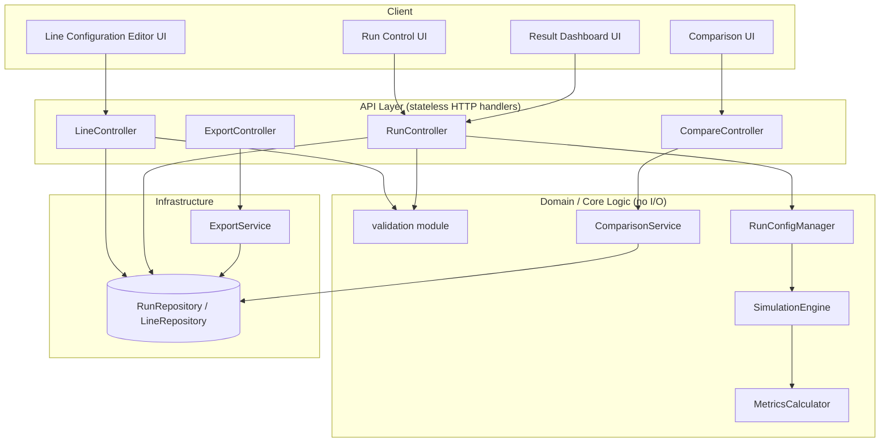

# Digital Twin Assembly-Line Simulation — Low-Level Design

**Based on:** `high-level-design.md` and `digital-twin-assembly-line-requirements.md` (v0.2). This document refines the logical components of the high-level design into concrete modules, data structures, algorithms, APIs, and a persistence schema. Where the high-level design and requirements left a choice open (Section 12 of the HLD, D-12), a concrete but swappable technology choice is proposed here and flagged **(implementation choice)**.

## 1. Purpose and Scope

This document is the implementation blueprint for engineers building the system described in the high-level design. It specifies:
- Module/package boundaries and their responsibilities.
- Concrete data structures (domain model, event types, API payloads, DB schema).
- The simulation engine's algorithm, including event-ordering and boundary-rule implementation.
- API contract (endpoints, request/response shapes, error format).
- Validation rules mapped to fields and error codes.
- Non-functional implementation notes (performance, security, testability).

It does not re-derive *why* decisions were made — see the Decision Log (D-01..D-12) in the requirements document for rationale; this document only states *how* each decision is implemented.

## 2. Technology Choices (implementation choice)

| Concern | Choice | Notes |
| --- | --- | --- |
| Client | Single-page app (framework-agnostic component breakdown below; React used for illustration) | Talks to API only over HTTPS/JSON |
| API/server language | TypeScript (Node.js) or Python — examples below use TypeScript-style pseudocode | Simulation engine is pure, side-effect-free, language choice does not affect its design |
| Persistence | Relational store (PostgreSQL) **or** embedded/file store (SQLite) for small deployments | Schema in Section 7 is engine-agnostic SQL |
| Transport | REST over HTTPS, JSON bodies | Matches FR-19/D-09 (JSON-only) |
| Auth | Deferred per HLD §12; API designed so an auth middleware can be inserted at the boundary without touching domain logic | — |

These choices are substitutable; every module boundary below is defined by its interface, not its implementation language.

## 3. Module Map



**Key design rule (NFR-06):** `validation`, `RunConfigManager`, `SimulationEngine`, `MetricsCalculator`, and `ComparisonService` are pure functions/classes with no network or DB calls, so they are unit-testable in isolation. All I/O (persistence, HTTP) lives in the API and Infra layers.

## 4. Domain Model (types)

```ts
// --- Configuration (user input) ---
interface DowntimeSchedule {
  startOffsetMin: number;   // >= 0
  durationMin: number;      // > 0
  repeatEveryMin?: number;  // omitted => one-time
}

interface Station {
  id: string;               // unique within a Line
  name: string;
  cycleTimeMin: number;     // > 0
  bufferCapacityOut: number; // >= 0, integer; capacity of buffer to next station
  batchSize: number;        // >= 1, integer; transfer grouping at this station's output
  downtime: DowntimeSchedule[];
}

interface Line {
  id: string;
  name: string;
  stations: Station[];      // ordered; index 0..n-1 defines serial topology (D-01)
  createdAt: string;
  updatedAt: string;
}

interface RunInput {
  horizonMin: number;              // > 0
  initialWipByStation: Record<string, number>; // station.id -> count >= 0
  seed?: number;                   // reserved for future stochastic model (FR-11)
}

// --- Immutable run snapshot (FR-10, FR-12) ---
interface RunConfig {
  runId: string;
  baselineRunId?: string;          // set when this run is a scenario (FR-10)
  lineSnapshot: Line;              // deep copy at run creation time, never mutated
  runInput: RunInput;
  modelVersion: string;            // e.g. "sim-1.0.0", tied to Decision Log revision
  createdAt: string;
}

// --- Results ---
interface StationMetrics {
  stationId: string;
  busyMin: number;
  scheduledDowntimeMin: number;
  blockedMin: number;
  starvedMin: number;
  utilization: number;             // busy / (horizon - scheduledDowntime), D-07
}

interface RunResult {
  runId: string;
  totalOutput: number;             // D-05: strictly before horizon end
  throughputPerMin: number;        // totalOutput / horizonMin
  wipSeries: Array<{ tMin: number; wip: number }>;
  wipAtEnd: number;
  stationMetrics: StationMetrics[];
  bottleneckStationId: string;     // D-07 tie-break rule
  computedAt: string;
}
```

## 5. Validation Module

Pure function `validateLine(line: Line): ValidationError[]` and `validateRunInput(line: Line, input: RunInput): ValidationError[]`, called by the API before any run is created (FR-04, NFR-02).

```ts
interface ValidationError {
  field: string;     // e.g. "stations[2].cycleTimeMin"
  code: string;       // e.g. "CYCLE_TIME_NOT_POSITIVE"
  message: string;    // user-facing, no stack traces / internal paths (OWASP A09 logging/exposure)
}
```

| Rule | Field | Error code | Source |
| --- | --- | --- | --- |
| `cycleTimeMin > 0` | `stations[i].cycleTimeMin` | `CYCLE_TIME_NOT_POSITIVE` | FR-02, AC-07 |
| `bufferCapacityOut >= 0`, integer | `stations[i].bufferCapacityOut` | `BUFFER_CAPACITY_NEGATIVE` | FR-03, AC-07 |
| `durationMin > 0` | `stations[i].downtime[j].durationMin` | `DOWNTIME_DURATION_NOT_POSITIVE` | FR-07, AC-07 |
| downtime scheduled within horizon | `stations[i].downtime[j].startOffsetMin` | `DOWNTIME_OUTSIDE_HORIZON` | FR-07 |
| `batchSize >= 1`, integer | `stations[i].batchSize` | `BATCH_SIZE_INVALID` | FR-08, AC-07 |
| `horizonMin > 0` | `runInput.horizonMin` | `HORIZON_NOT_POSITIVE` | FR-05 |
| `initialWip >= 0`, integer, station exists | `runInput.initialWipByStation[id]` | `INITIAL_WIP_INVALID` | FR-05 |
| station ids unique, non-empty | `stations[i].id` | `STATION_ID_DUPLICATE` | FR-02 |
| all numeric fields finite (reject NaN/Infinity/non-numeric) | varies | `FIELD_NOT_NUMERIC` | NFR-02, OWASP input validation |

Validation runs server-side regardless of client-side checks (defense in depth, OWASP A03/A04). All rules are additive — the API collects *every* violation and returns them together (US-05), not just the first one found.

## 6. Simulation Engine

### 6.1 Event model

```ts
type EventType = "DOWNTIME_END" | "COMPLETION" | "DOWNTIME_START" | "ARRIVAL";

interface SimEvent {
  tMin: number;
  type: EventType;
  stationIndex: number;
  // priority used only to break ties at equal tMin, per D-06
}

const EVENT_PRIORITY: Record<EventType, number> = {
  DOWNTIME_END: 0,
  COMPLETION: 1,
  DOWNTIME_START: 2,
  ARRIVAL: 3,
};
```

The engine uses a **priority queue (min-heap)** keyed by `(tMin, EVENT_PRIORITY[type], insertionSeq)`. `insertionSeq` is a monotonically increasing counter used only to make heap comparisons total-ordered (never to break the D-06 tie rule itself) and keeps the engine deterministic even on tied `(tMin, priority)` pairs created at the same simulation step.

### 6.2 Station state machine

Each station index `i` tracks:

```ts
interface StationState {
  busyMin: number;
  scheduledDowntimeMin: number;
  blockedMin: number;
  starvedMin: number;
  inProcessCount: number;        // units currently at this station (processing or queued)
  completedBatch: number;        // completed units awaiting batch transfer
  bufferOut: number;             // units currently sitting in the downstream buffer
  isDown: boolean;
  isBlocked: boolean;
  nextDowntimeIdx: number;       // index into sorted downtime schedule
}
```

State transitions per event type:
- **DOWNTIME_END:** `isDown = false`; if the station had a unit ready to start, schedule a new `COMPLETION` at `t + cycleTimeMin`.
- **COMPLETION:** increment `completedBatch`. If `completedBatch == batchSize` **and** downstream buffer has capacity (or there is no downstream station), transfer the batch: `bufferOut += batchSize`, `completedBatch = 0`, push `ARRIVAL` event(s) to the downstream station at `t`. If downstream buffer lacks capacity, station becomes `isBlocked = true` (blocked-time accrual starts at `t`) and the transfer is retried on the next relevant event (downstream `COMPLETION`/consumption) rather than scheduled as a timer.
- **DOWNTIME_START:** `isDown = true`; if mid-cycle, the in-process unit's completion is deferred (re-scheduled) to after `durationMin`.
- **ARRIVAL:** if the station is idle and not down and not blocked, start processing (`inProcessCount += 1`) and schedule `COMPLETION` at `t + cycleTimeMin`; otherwise the unit waits in the upstream buffer (already accounted for by `bufferOut` of the upstream station).

Blocked/starved time is accrued by integrating `isBlocked` / `isStarved` (station idle with empty input and no WIP) over wall-clock simulation time between processed events, not by a separate timer event — this avoids inflating the event queue and keeps the engine O(number of real events), satisfying NFR-03.

### 6.3 Core loop (pseudocode)

```ts
function runSimulation(config: RunConfig): { result: RunResult; trace?: SimEvent[] } {
  const horizon = config.runInput.horizonMin;
  const stations = initStations(config.lineSnapshot, config.runInput.initialWipByStation);
  const queue = new MinHeap<SimEvent>(compareByTimeThenPriority);
  const wipSeries: Array<{ tMin: number; wip: number }> = [];
  let totalOutput = 0;

  seedInitialEvents(queue, stations, config.lineSnapshot); // downtime starts, first arrivals, initial-WIP completions

  let lastT = 0;
  while (!queue.isEmpty()) {
    const ev = queue.peek();
    if (ev.tMin >= horizon) break; // D-05: horizon-boundary events are not executed
    queue.pop();
    accrueIdleStates(stations, lastT, ev.tMin); // integrate blocked/starved time since lastT
    lastT = ev.tMin;

    applyEvent(ev, stations, queue, config.lineSnapshot);

    if (isLastStationOutputEvent(ev, config.lineSnapshot)) {
      totalOutput += 1;
    }
    wipSeries.push({ tMin: ev.tMin, wip: computeWip(stations) });
  }
  accrueIdleStates(stations, lastT, horizon); // close out remaining idle time to horizon end

  const stationMetrics = computeStationMetrics(stations, horizon);
  const bottleneckStationId = selectBottleneck(stationMetrics, config.lineSnapshot);

  return {
    result: {
      runId: config.runId,
      totalOutput,
      throughputPerMin: totalOutput / horizon,
      wipSeries,
      wipAtEnd: computeWip(stations),
      stationMetrics,
      bottleneckStationId,
      computedAt: new Date().toISOString(),
    },
  };
}
```

**Determinism (NFR-01, AC-06):** the heap comparator is total and depends only on `(tMin, EVENT_PRIORITY, insertionSeq)`, all derived deterministically from input; no `Date.now()`, external randomness, or object-identity-based ordering is used inside the loop. A future stochastic downtime model (D-02) plugs in via a `DowntimeProvider` interface (Section 6.4) seeded from `config.runInput.seed`, without changing the loop above.

### 6.4 Downtime extension point

```ts
interface DowntimeProvider {
  nextDowntimeEvents(station: Station, horizon: number): SimEvent[];
}

class ScheduledDowntimeProvider implements DowntimeProvider { /* reads Station.downtime, expands repeats within horizon */ }
// Future: class StochasticDowntimeProvider implements DowntimeProvider { /* MTBF/MTTR, seeded RNG */ }
```

The engine depends only on `DowntimeProvider`, isolating the D-02 future extension as the HLD §5 requires.

### 6.5 Metrics Calculator

```ts
function computeStationMetrics(stations: StationState[], horizon: number): StationMetrics[] {
  return stations.map(s => {
    const available = horizon - s.scheduledDowntimeMin;
    return {
      stationId: s.id,
      busyMin: round2(s.busyMin),
      scheduledDowntimeMin: round2(s.scheduledDowntimeMin),
      blockedMin: round2(s.blockedMin),
      starvedMin: round2(s.starvedMin),
      utilization: available > 0 ? round2(s.busyMin / available) : 0, // D-07
    };
  });
}

function selectBottleneck(metrics: StationMetrics[], line: Line): string {
  // Greatest busy time; ties broken by greatest blocked time (D-07)
  return metrics
    .slice()
    .sort((a, b) => b.busyMin - a.busyMin || b.blockedMin - a.blockedMin)[0].stationId;
}
```

`round2` rounds only the *displayed* value; raw sums use full floating-point/decimal precision internally (NFR-05). **(implementation choice)** use a fixed-point/decimal type (not native float) for time accumulation to avoid floating-point drift over long horizons (100,000 min, NFR-03).

## 7. Persistence Schema (relational, engine-agnostic SQL)

```sql
CREATE TABLE line (
  id            TEXT PRIMARY KEY,
  name          TEXT NOT NULL,
  config_json   TEXT NOT NULL,   -- current Line, including stations (source of truth for edits)
  created_at    TIMESTAMP NOT NULL,
  updated_at    TIMESTAMP NOT NULL
);

CREATE TABLE run (
  id                 TEXT PRIMARY KEY,
  line_id            TEXT NOT NULL REFERENCES line(id),
  baseline_run_id    TEXT NULL REFERENCES run(id), -- null = baseline run; set = scenario (FR-10)
  line_snapshot_json TEXT NOT NULL,   -- immutable copy of Line at run creation time
  run_input_json     TEXT NOT NULL,   -- horizon, initial WIP, seed
  model_version      TEXT NOT NULL,
  created_at         TIMESTAMP NOT NULL
);

CREATE TABLE run_result (
  run_id             TEXT PRIMARY KEY REFERENCES run(id),
  total_output       INTEGER NOT NULL,
  throughput_per_min REAL NOT NULL,
  wip_at_end         INTEGER NOT NULL,
  station_metrics_json TEXT NOT NULL,  -- array of StationMetrics
  wip_series_json      TEXT NOT NULL,  -- array of {tMin, wip}; may be summarized/downsampled (HLD open item)
  bottleneck_station_id TEXT NOT NULL,
  computed_at        TIMESTAMP NOT NULL
);
```

- `run` never updates `line_snapshot_json`/`run_input_json` after insert — enforced at the repository layer (append-only), satisfying FR-10/FR-12 immutability.
- `line.config_json` is the only mutable record; editing a line never touches past `run` rows.
- Indices: `run(line_id)`, `run(baseline_run_id)` for scenario lookups and comparisons.

## 8. API Contract

Base path `/api/v1`. All bodies JSON; all errors use a uniform envelope.

```jsonc
// Error envelope (no stack traces or internal paths — OWASP A09)
{ "errors": [ { "field": "stations[2].cycleTimeMin", "code": "CYCLE_TIME_NOT_POSITIVE", "message": "Cycle time must be greater than zero." } ] }
```

| Method & path | Purpose | Request | Success response | Req traces |
| --- | --- | --- | --- | --- |
| `POST /lines` | Create a line | `Line` (no id) | `201 Line` | FR-01..FR-04 |
| `PUT /lines/{id}` | Update a line | `Line` | `200 Line` | FR-01..FR-04 |
| `GET /lines/{id}` | Fetch a line | — | `200 Line` | — |
| `POST /lines/{id}/runs` | Create & execute a run (baseline or scenario) | `{ runInput: RunInput, baselineRunId?: string, overrides?: Partial<Line> }` | `201 { runConfig: RunConfig, result: RunResult }` | FR-05, FR-09..FR-13, FR-10 |
| `GET /runs/{id}` | Fetch a run + result | — | `200 { runConfig: RunConfig, result: RunResult }` | FR-12, US-10 |
| `GET /runs?lineId=&baselineRunId=` | List runs for a line/scenario set | — | `200 RunConfig[]` | — |
| `GET /runs/compare?a={runId}&b={runId}` | Compare two runs | — | `200 ComparisonResult` | FR-17, AC-08 |
| `GET /runs/{id}/export` | Export run as JSON | — | `200 application/json` file | FR-19, AC-09 |

`400` for validation errors (error envelope above), `404` for missing line/run, `409` if a run references a baseline from a different line.

### 8.1 Comparison payload

```ts
interface ComparisonResult {
  runA: string; runB: string;
  inputDiffs: Array<{ field: string; valueA: unknown; valueB: unknown }>;
  metricDiffs: {
    throughputPerMin: number; totalOutput: number; wipAtEnd: number;
    utilizationByStation: Record<string, number>;
    bottleneckChanged: boolean;
  };
  warnings: string[]; // e.g. "Horizon differs (A=100000, B=50000): comparison may be misleading" (FR-17, Risks)
}
```

`ComparisonService.compare(a: RunConfig, b: RunConfig): ComparisonResult` is a pure function operating only on the two `RunConfig`/`RunResult` pairs fetched by the controller — it emits a `warnings` entry whenever `horizonMin`, units (always minutes per D-08, so this check is a no-op today but kept for forward-compatibility), or any `initialWipByStation` entry differs (AC-08, US-16).

## 9. Security Notes (OWASP mapping)

- **A03 Injection:** No string-concatenated SQL; use parameterized queries/ORM for all repository access.
- **A01/A04 Broken access control / insecure design:** Auth middleware is a pluggable layer in front of the API controllers (HLD §12 open item); until implemented, document that the service is single-tenant/trusted-network only.
- **A05 Security misconfiguration & A09 Logging failures:** Validation and runtime errors never surface stack traces, file paths, or internal identifiers to the client; server-side logs capture full detail separately.
- **A08 Software/data integrity:** `run` rows are append-only (Section 7) so historical results cannot be silently altered; `modelVersion` on every run record lets consumers detect when results came from a changed engine.
- Export files (Section 8) contain only line/run configuration and computed metrics — never credentials, tokens, or environment data.

## 10. Testability Mapping (NFR-06)

| Layer | How it's tested |
| --- | --- |
| `validateLine` / `validateRunInput` | Pure unit tests, one per rule in Section 5 (covers AC-07) |
| `SimulationEngine.runSimulation` | Pure unit tests against hand-calculated AC-01..AC-05 scenarios, plus dedicated boundary tests for D-05 (horizon boundary) and D-06 (event-ordering ties) |
| `MetricsCalculator` | Unit tests for utilization/bottleneck formulas (D-07), independent of the event loop, using pre-built `StationState` fixtures |
| `ComparisonService.compare` | Unit tests with fixed `RunConfig`/`RunResult` fixtures covering AC-08 and the AC-08/US-16 warning cases |
| API controllers | Integration tests hitting the HTTP layer, asserting error envelope shape and status codes |
| Repository | Integration tests against a real (test) database instance, asserting append-only behavior for `run`/`run_result` |

## 11. Open Items Carried Forward

- Concrete auth/multi-tenancy model (HLD §12, still open).
- Whether `wip_series_json` is stored at full event resolution or downsampled for large horizons (storage/performance trade-off, HLD §12).
- `StochasticDowntimeProvider` design (seed handling, distribution parameters) when D-02's future extension is scheduled.
